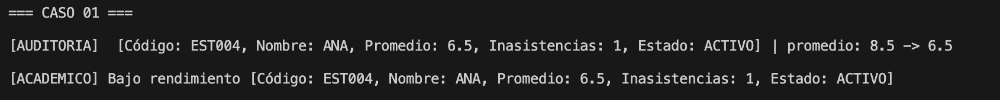
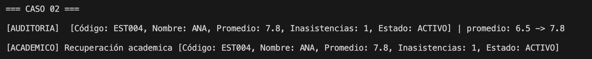
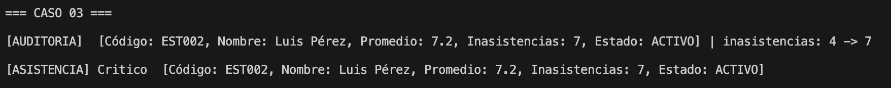
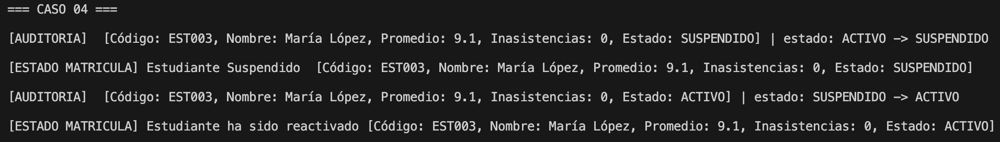
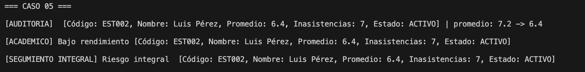
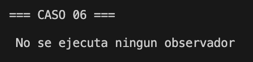
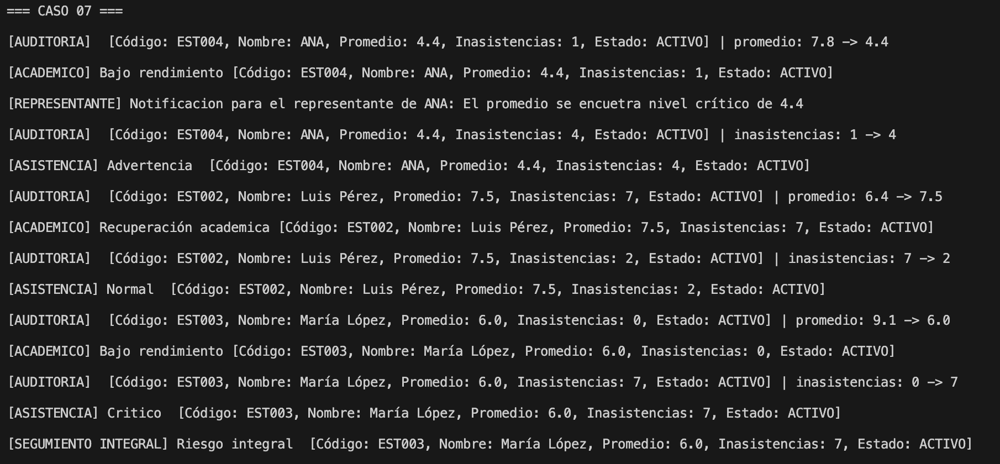
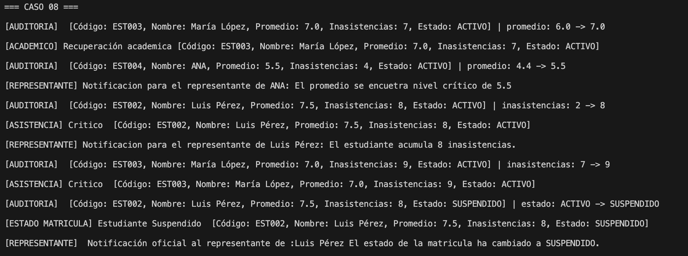

## Caso 1. Disminución del rendimiento académico

## Caso 2. Recuperación académica

## Caso 3. Cambio de nivel de asistencia

## Caso 4. Modificación del estado de matrícula

## Caso 5. Identificación de riesgo integral

## Caso 6. Modificaciones sin cambios reales

## Caso 7. Observación de múltiples estudiantes

## Caso 8. Incorporación de un nuevo observador

