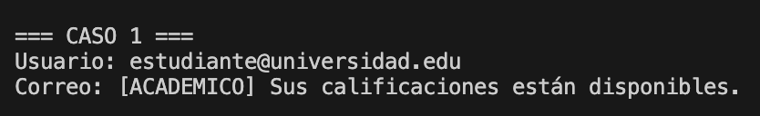
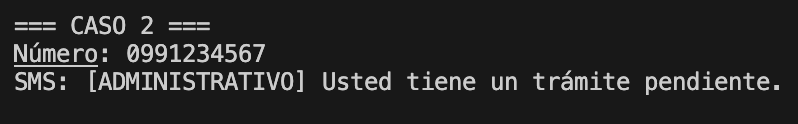
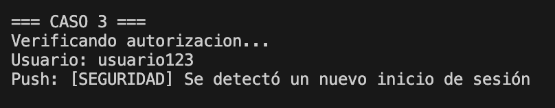
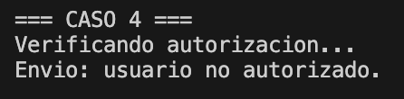
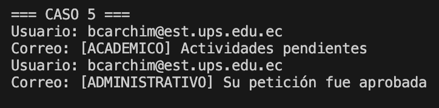
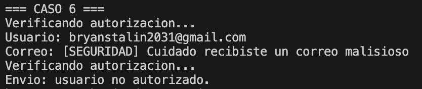

# Caso 1. Notificación académica por correo electrónico

# Caso 2. Notificación administrativa por SMS

# Caso 3. Notificación de seguridad con autorización

# Caso 4. Notificación académica sin autorización

# Caso 5. Reutilización del mismo canal con diferentes notificaciones

# Caso 6. Combinación de Bridge y Proxy con diferentes canales
